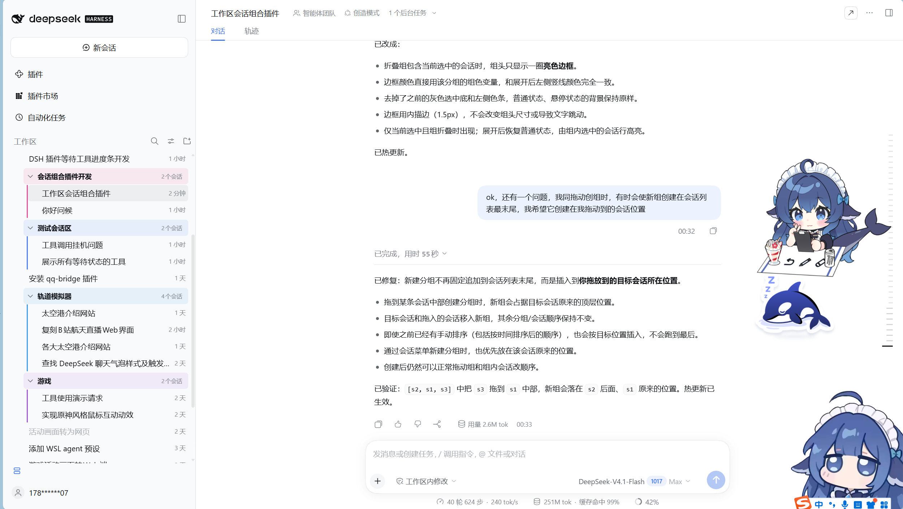
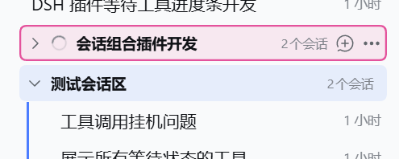
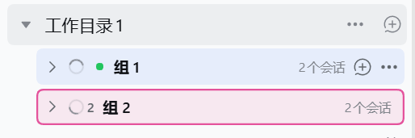
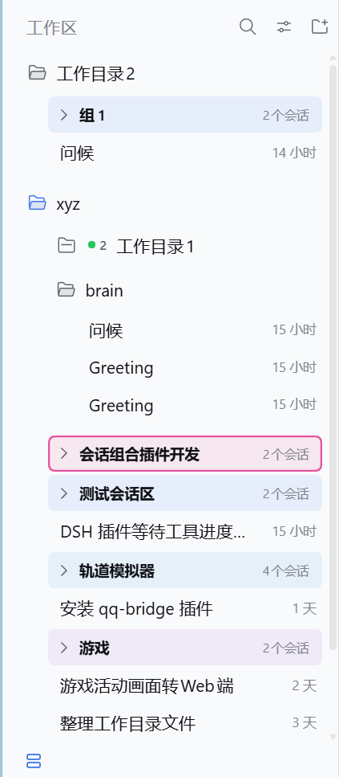
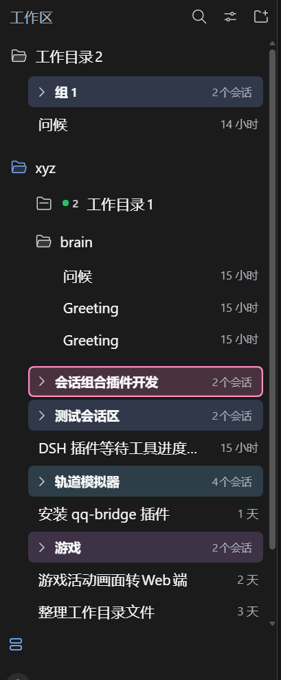
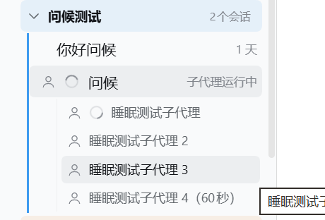
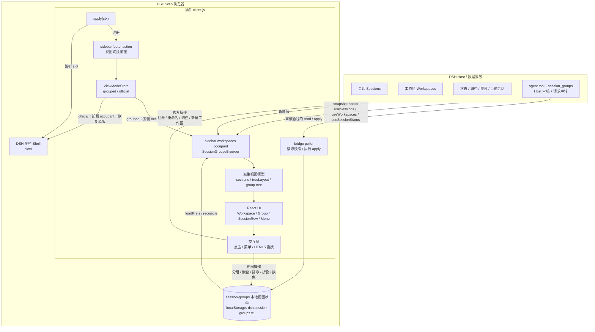

<p align="center">
  
</p>

<h1 align="center">DSH Session Groups</h1>

<p align="center">
  把 <strong>Edge 浏览器的标签页分组</strong>体验，搬到 DSH Web / Desktop 的会话侧栏。
  <br>
  <strong>彩色分组、折叠、拖动排序、状态汇总</strong>，让一长串会话重新变得可管理；也可以让 AI 读取现状、经你审核后整理分组。
  <br>
  支持 <strong>DSH Web / DSH Desktop</strong>；支持子代理展开与状态联动。
  <br><br>
  <code>v0.4.1</code> · DSH Web / Desktop Plugin · MIT
</p>

<p align="center">
  <a href="#界面预览">界面预览</a> ·
  <a href="#为什么">为什么</a> ·
  <a href="#功能">功能</a> ·
  <a href="#架构">架构</a> ·
  <a href="#安装">安装</a> ·
  <a href="#快速上手">快速上手</a> ·
  <a href="#数据与兼容性">数据与兼容性</a> ·
  <a href="#常见问题">FAQ</a>
</p>

---

## 界面预览

<p align="center">
  
</p>

<p align="center">
  <sub>在 DSH Web 侧栏中用分组管理会话：支持组内分组、折叠状态汇总和工作区树。</sub>
</p>

| 分组与选中态 | 折叠组状态汇总 |
| :---: | :---: |
|  |  |
| 选中会话所在的组折叠时，组头会显示组色边框 | 折叠组汇总组内状态：运行中、等待、已完成的会话一目了然 |

### 浅色 / 深色主题

| 浅色主题 | 深色主题 |
| :---: | :---: |
|  |  |
| 浅色模式保持原来的组色 | 深色模式使用单独提亮的分组配色 |

### 分组计数与子代理状态

<p align="center">
  
</p>

<p align="center">
  <sub>组头右侧显示组内会话数；父会话自身回合结束后，只要子代理仍在运行，仍会显示「子代理运行中」。子代理行只在运行中显示转圈。</sub>
</p>

## 为什么

DSH 里会话会越来越多。默认列表只有时间和标题，时间一长就变成一条很长的流水账；靠置顶和归档只能缓解，不能组织。

Edge 的标签页分组给了一个很直接的答案：**把同类的东西收进一个彩色分组，折叠起来，需要时再展开**。这个插件把同一个心智模型搬到了 DSH 的会话侧栏：

- 工作区是外层边界，分组只在当前工作区内生效。
- 分组像 Edge 的标签组一样有颜色、可以折叠、可以拖动。
- 组和未分组会话处于同一级，想放哪里就放哪里。
- 收起分组后，组内会话的状态仍然会汇总在组头上，不会因为折叠而丢失信息。

## 功能

### 像 Edge 标签页一样分组

- **拖入分组**：把会话拖到另一条会话的中部，即可创建新分组，或加入目标会话所在分组。
- **精确排序**：拖到会话的上半区 / 下半区，插入到对应位置。
- **同级混排**：分组和未分组会话可以一起拖动排序，不会永远把组压在最上面。
- **组内继续拖动**：组内会话可以重新排序，也可以拖出分组。
- **拖动嵌套分组**：把组拖到另一个组的中间即可嵌套，最多 3 层（最外层算第 1 层）；把组拖到工作区空白、顶层会话或根组边缘可移出并重新排序；把组拖到组内会话的上/下边缘可插入到组内对应位置。同一组内的两条会话拖到彼此中部，会在该组内生成子组，与最外层拖动会话建组一致。子组默认出现在本组列表底部，之后可拖到组内会话之间调整位置；组内元素顺序可自由调整。子组保留颜色、改名、折叠、状态汇总和组内会话拖拽。解散子组时，组内会话和子组会留在父组内，不会散到最外层。超过 3 层时会提示无法继续嵌套。
- **工作区隔离**：分组严格属于当前工作区；跨工作区拖拽会被拒绝。
- **按工作区树划分**：在视图选项中开启后，子工作区按目录层级嵌套显示，父工作区折叠会收起整棵子树；当前会话所在树的祖先会自动展开。
- **单列表**：在视图选项中切换为一条跨工作区的会话列表；分组保持完整，不会被拆散成单个会话。
- **工作区划分**：视图选项里用三个图标切换「工作区 / 工作区树 / 单列表」，选中项右侧显示 ✓，悬停可看对应名称。
- **递归排序**：视图选项提供「按时间顺序排序」和「按首字母排序」，每层递归排序；组和子工作区按内部最晚时间 / 名称首字母排序。汉字按拼音首字母（如 会话 → hh、游戏 → yx）。
- **折叠工作区状态**：最外层工作区和子工作区折叠时，都会像折叠分组一样在标题旁汇总内部会话的运行 / 等待 / 完成状态，相同状态显示数量。
- **分组计数**：组头右侧显示组内会话总数，折叠后仍保留状态汇总。
- **折叠子工作区选中态**：当前打开的会话位于某个折叠的子工作区中时，该子工作区标题会显示深灰色选中背景。
- **子代理联动**：有子代理的会话可以展开其直接子代理并显示运行状态；没有子代理时完全隐藏。详见下方「子代理支持」。
- **未分组桶与原版一致**：不属于任何工作区的会话汇总为末尾的「未分组」伪工作区；文件夹图标、折叠、状态汇总、置顶 / 当前空白会话优先和拖动排序都按工作区处理，但没有重命名 / 删除等工作区菜单。
- **8 种预设颜色 + RGB 自定义 + 改名 + 折叠 + 解散**：组头 `...` 菜单里都有；颜色列表最左侧的 RGB 入口可以填写 R/G/B 自定义颜色。

### 子代理支持

- 有子代理的会话在悬停时左侧出现官方用户组图标；点击展开其直接子代理，展开后图标变为单人图标，每条子代理行也带单人图标
- 子代理运行中：子代理行显示运行转圈并把名称右移；空闲、完成未读、等待处理时保持原来的「图标 + 名称」布局
- 父会话联动：父会话自己的回合结束后，只要直接子代理仍在运行，父行会显示运行点并显示「子代理运行中」
- 没有子代理时：相关图标、行和状态完全隐藏

### 保留原版侧栏习惯

- 顶部「视图选项」可在**分组视图**和**原版视图**之间切换，原版视图保留 DSH 自带浏览器。
- 会话行保留原版图标和右键/悬停操作：置顶、重命名、分叉、归档 / 取消归档、复制 Session ID。
- **状态显示**与官方一致：运行中转圈、等待审批 / 计划待审 / 等待回答、运行结束未读绿点。
- 分组折叠时，组头会汇总组内状态；相同状态显示数量。
- 会话多时显示「展开其余 N 个会话」，展开后可「收起」。
- 已归档会话默认隐藏；可在「视图选项」中取消隐藏，显示为原版灰色标题。
- 工作区 `...` 菜单提供「按时间顺序排序」「按首字母排序」：组和会话一起重排，子工作区与组内也同步；排序后仍可自由拖动。
- 添加工作区使用与官方一致的目录浏览弹窗。

### 让 AI 整理会话区

- 内置 agent 工具 `session_groups`：模型可以先用 `read` 列出工作区，再按工作区读取会话和分组，最后用 `apply` 提交整理方案。
- `apply` 会先请求**用户审核**；用户看到改动摘要并批准后，才会写入分组。
- 方案必须覆盖指定工作区的每个可见会话且恰好一次：放进某个分组的 `sessionIds`，或放进 `ungroupedSessionIds`，避免误删会话。
- 支持创建 / 改名 / 换色 / 嵌套分组、调整组内会话、把会话放回未分组区。
- 需要在**分组视图**下使用；Host 只中转请求，分组仍保存在浏览器 localStorage。

例如可以直接对 AI 说：

> 把「xyz」工作区里和插件开发有关的会话整理成一个「插件开发」分组，其余的放回未分组区。

AI 会先读取现状，再提交方案；你在审核弹窗里确认后才会真正修改侧栏。

### 轻量、可回收

- 所有分组数据都是**浏览器本地视图状态**，不写入 DSH Session / Host 记录。
- 禁用或卸载插件后，原版侧栏自动恢复。
- 不引入 Harness Client 运行时包，只从模块表加载 React。

## 架构

插件通过 DSH 的 slot 接入，会话/工作区主数据由 DSH Host 提供；分组、顺序、折叠、颜色等是浏览器本地的视图叠加层。

> 完整时序图、渲染数据流和 Host/本地冲突处理见 [docs/architecture.md](docs/architecture.md)。

### 组件总览



---

### 数据职责

| 数据 | 权威所有者 | 插件行为 |
|---|---|---|
| 会话是否存在 | DSH Host | 只读快照；用于裁剪分组引用 |
| 会话属于哪个工作区 | DSH Host | 分组严格按工作区隔离 |
| 会话标题 / 状态 / 归档 / 置顶 | DSH Host | 渲染时直接读取，不写入本地 |
| 当前打开的会话 | DSH Host | 用于选中态 / 自动展开祖先 |
| 分组 / 子组 / 父组关系 | 插件本地 | 写入 localStorage |
| 组名 / 颜色 / RGB 自定义色 | 插件本地 | 写入 localStorage |
| 组和子组折叠状态 | 插件本地 | 写入 localStorage |
| 组内顺序 / 顶层顺序 / 子工作区顺序 | 插件本地 | 写入 localStorage |
| AI 整理请求 | Host approval + 浏览器校验 | 批准后由浏览器写入同一份本地状态 |
| 未分组桶 | DSH Host 会话成员关系 | 末尾伪工作区，顺序/折叠写浏览器本地 |
| 工作区树 / 单列表 / 隐藏归档 | 插件本地 | 写入 localStorage |

---

### 本地视图状态

存储键：

```text
dsh.session-groups.v1
```

结构概要：

```json
{
  "groups": {
    "workspaceId": [
      {
        "id": "g1",
        "name": "分组",
        "color": "#4c7dff",
        "collapsed": false,
        "parentGroupId": null,
        "sessionIds": ["sessionId1", "sessionId2"]
      }
    ]
  },
  "collapsedWorkspaces": {},
  "manualOrders": {},
  "topOrders": {},
  "childOrders": {},
  "groupOrders": {},
  "hideArchived": true,
  "workspaceTree": false,
  "flatList": false
}
```

注意：

- `sessionIds` 是 ID 引用，不是会话内容
- `groups` 是扁平数组，通过 `parentGroupId` 形成最多 3 层的树
- 组内“会话 + 子组”的顺序由 `groupOrders` 保存
- 所有 state 都是浏览器本地的，不跨设备同步

---

### 文件地图

| 文件 | 作用 |
|---|---|
| `client.js` | 插件全部运行时、派生渲染、拖拽、本地状态、UI、i18n |
| `index.js` | Host 入口：`session_groups` 工具、用户审核、bridge 请求队列与 Web 路由 |
| `locale/*.json` | 插件元数据本地化 |
| `docs/` | 预览图、主题图、架构文档 |
| `README.md` | 使用说明与功能预览 |

---

## 安装

### 前置条件

- 已安装并运行 **DSH Web** 或 **DSH Desktop**
- DSH 版本满足 `>=0.2.1-rc.2 <0.3.0`
- 当前 Web profile 允许安装本地插件

### 从 GitHub 克隆安装

```bash
git clone https://github.com/xyzYaeMiko/dsh-session-groups.git
dsh plugin install "$PWD/dsh-session-groups"
```

安装后刷新 DSH Web，或重启 DSH Desktop。

### 从本地目录安装

1. 打开 DSH 的插件管理面板。
2. 选择「从本地目录安装」。
3. 选中本项目根目录（包含 `package.json`、`cordis.patch.yml` 的目录）。
4. 安装完成后刷新页面 / 重启 Desktop。

安装成功后，侧栏底部会出现**分组视图切换按钮**。

## 快速上手

1. 点击侧栏底部的分组按钮，进入分组视图。
2. 把一条会话拖到另一条会话的**中间**：新建或加入分组。
3. 把会话拖到另一条会话的**上/下半区**：调整位置，不分组。
4. 拖动组头：调整分组在会话列表里的位置。
5. 双击组名：重命名；组头 `...`：换色、折叠、解散。
6. 想回到原版侧栏：顶部「视图选项」→「原版视图」。

## 数据与兼容性

| 项目 | 说明 |
| --- | --- |
| 存储键 | `dsh.session-groups.v1` |
| 存储位置 | 浏览器 localStorage |
| 存储内容 | 分组、颜色、折叠状态、顶层顺序、子工作区顺序、手动排序、隐藏已归档偏好 |
| 同步 | 不跨浏览器 / 不跨 profile / 不跨 origin |
| 写入 Host | 否，只做视图层重组 |
| 平台 | DSH Web、DSH Desktop（Electron；v0.2.1 已实测正常） |
| 卸载 | 禁用或卸载插件后，原版侧栏恢复 |

> 清除浏览器站点数据会丢失分组。分组状态不会上传到任何服务器。

## 常见问题

**Q：刷新后分组会消失吗？**  
A：0.2.0 已修复启动时工作区数据未就绪导致的误清理。分组保存在 localStorage，正常刷新会保留。

**Q：分组会同步到其他浏览器或设备吗？**  
A：不会。目前是当前 origin / profile 的本地视图状态。

**Q：可以不用分组视图吗？**  
A：可以。顶部「视图选项」切回「原版视图」即可，原来的 DSH 侧栏会恢复。

**Q：AI 整理会改坏我的分组吗？**  
A：`apply` 前需要你审核，未批准不会写入。方案还会先校验工作区归属、会话是否恰好覆盖一次以及嵌套层数，校验失败会拒绝执行；分组仍保存在本地，Host 只中转请求。

**Q：支持 DSH Desktop 吗？**  
A：支持，已经在 v0.2.1 的 DSH Desktop 上实测正常。Desktop 复用同一套 DSH Web 客户端，分组、拖拽、排序、子代理展开和状态联动都可以使用。AI `session_groups` 工具依赖本地 Web 桥接，桌面构建提供 Web 服务时同样可用；没有 Web 服务时只保留侧栏功能。

## 版本历史

### v0.4.1

- 子代理展开直接读取 `subagentCatalog`
- 移除插件可用性探测、监听和相关注入代码
- 没有子代理时，相关 UI 完全隐藏

### v0.4.0

- 支持 DSH Web 与 DSH Desktop（Electron）；DSH Desktop 在 v0.2.1 实测正常，当前版本继续复用同一客户端，侧栏分组、拖拽、排序、子代理展开和状态联动可用
- Host 入口把 Web 桥接依赖改为可选：桌面端即使没有 `webServer` 也不会阻塞客户端加载；AI `session_groups` 工具只在存在 Web 桥接时注册
- 子代理行只在运行中显示状态转圈，其余状态保持「图标 + 名称」布局

### v0.3.3

- 子代理行只在运行中显示状态转圈；空闲、完成未读、等待处理都不再显示子代理状态点
- 子代理没有运行状态时保持原版「单人图标 + 名称」布局，不预留空状态位
- 父会话仍会在直接子代理运行时显示「子代理运行中」

### v0.3.2

- 子代理行新增运行 / 完成 / 等待状态点
- 父会话在自身结束后，只要仍有直接子代理运行，就显示运行状态点和「子代理运行中」，不再错误显示空闲
- 子代理运行状态增加 `subagentTiming.active` 后备判断，避免状态快照晚到导致父会话短暂显示空闲
- 状态点悬停提示现在包含完整状态文案

### v0.3.1

- 「未分组」改为与 DSH 原版一致的末尾伪工作区：文件夹图标、折叠 / 展开、状态汇总
- 未分组会话沿用原版顺序：置顶优先、当前空白会话优先、其余按最近更新，并支持拖动手动排序
- 未分组桶没有工作区重命名 / 删除菜单，也不会凭空新建会话
- 折叠状态和手动排序保存在浏览器本地，和普通分组视图一致

### v0.3.0

- 新增 agent 工具 `session_groups`：AI 可以读取会话区现状并提交分组整理方案
- 写入前通过 DSH approval 请求用户审核；拒绝、取消或审核不可用时不修改数据
- 方案需覆盖工作区全部可见会话，防止整理时漏掉或重复引用会话
- 支持分组创建 / 改名 / 颜色 / 折叠 / 最多 3 层嵌套 / 组内顺序 / 未分组区
- Host 只负责审核与请求中转，分组数据仍保存在浏览器 localStorage

### v0.2.2

- 有子代理的会话在悬停时会显示官方用户组图标
- 点击图标在会话下方展开其派遣的直接子代理；展开后图标切换为单人图标
- 每条子代理带单人图标，点击可打开对应子代理会话
- 没有子代理时，该功能及其 UI 完全不出现

### v0.2.1

- 折叠状态汇总扩展到最外层工作区；折叠任意工作区都会显示其内部运行 / 等待 / 完成状态
- 新增组内分组，最多 3 层；组可以拖到另一个组中部嵌套，拖到边缘或跨层位置插入，拖到工作区空白处移出
- 组内会话拖到同组另一条会话中部会合并创建子组，子组可以继续嵌套到第 3 层
- 组内「直接会话 + 子组」支持混合排序，子组默认位于组内列表底部，之后可拖到会话之间调整位置
- 解散子组时，直接会话和子组会留在父组内，不会散到最外层
- 新增分组 RGB 自定义颜色：R/G/B 数值填写、颜色预览、非法值提示，自定义色刷新后保留
- 「移动到分组」列表限制高度并支持内部滚动，组较多时不会把「解散分组」挤出菜单
- 超过 3 层限制时显示提示；正常换位、嵌套等操作不再弹提示
- 组拖拽排序补充蓝线插入、跨层移动和同层重排反馈
- 修复自定义颜色刷新后丢失、失效的组内排序键残留等问题

### v0.2.0

- 新增「工作区 / 工作区树 / 单列表」三种工作区划分，合并为图标选择栏，选中项显示 ✓，悬停显示名称
- 新增工作区树：按目录路径嵌套、子工作区缩进、父级折叠收起子树
- 子工作区折叠时汇总内部状态；当前会话位于折叠子工作区时显示选中态
- 新增单列表：跨工作区汇总显示，分组保持完整
- 视图选项和单工作区菜单新增递归排序：按时间、按拼音首字母
- 深色模式专用分组配色，浅色配色保持不变
- 分组选中边框、折叠组状态汇总、子工作区会话对齐、新建分组插入目标位置、刷新后分组持久化等细节完善

### v0.1.0

首个公开版本：

- 彩色会话分组、折叠 / 展开、重命名、解散
- 组与未分组会话同级拖动排序
- 工作区级隔离
- 分组视图 / 原版视图切换
- 状态点、归档会话显示、展开水位线
- 与官方一致的目录选择器

## License

MIT © 2026 dsh-session-groups contributors
