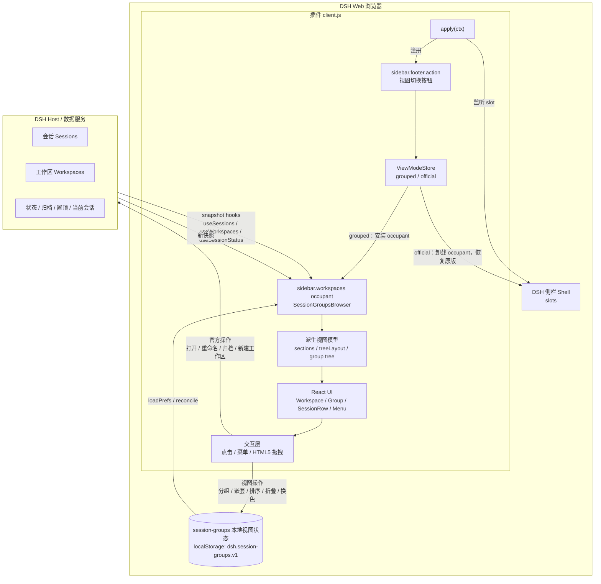
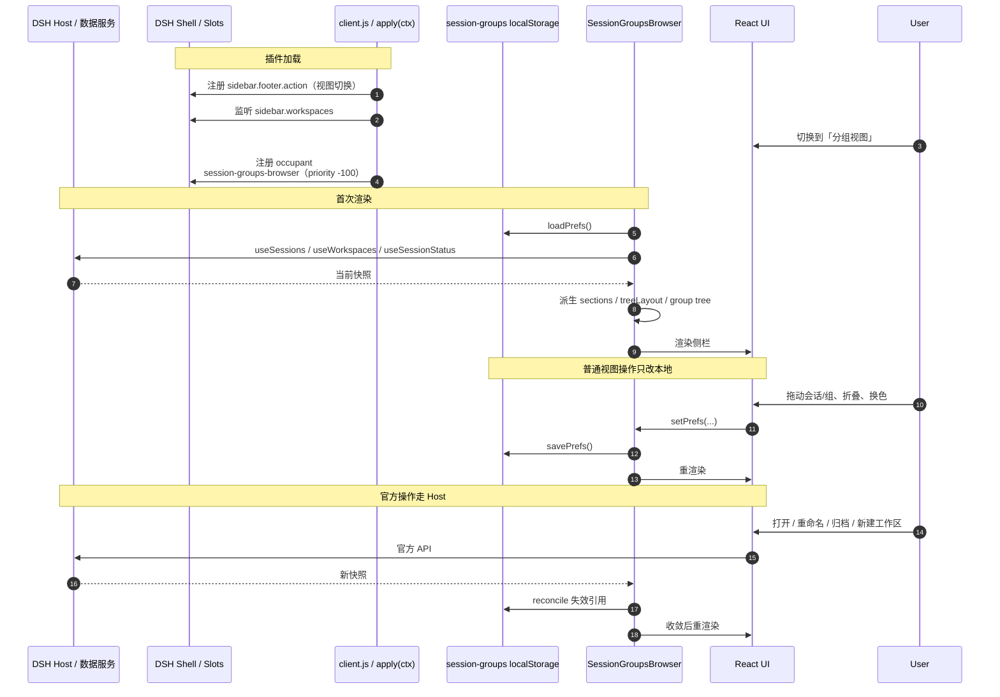

# DSH Session Groups 架构

本文说明插件如何与 **DSH 侧栏 / 控制器** 以及 **session-groups 本地视图状态** 交互。

核心原则：

> DSH 负责“有什么”；插件本地负责“怎么排”。  
> 会话/工作区主数据由 DSH Host 持有；分组、折叠、顺序、颜色是浏览器本地的视图叠加层。

---

## 1. 组件总览



---

## 2. 启动与 slot 注册



---

## 3. 数据职责

| 数据 | 权威所有者 | 插件行为 |
|---|---|---|
| 会话是否存在 | DSH Host | 只读快照；用于裁剪分组引用 |
| 会话属于哪个工作区 | DSH Host | 分组严格按工作区隔离 |
| 会话标题 / 状态 / 归档 / 置顶 | DSH Host | 渲染时直接读取，不写入本地 |
| 当前打开的会话 | DSH Host | 用于选中态 / 自动展开祖先 |
| 分组 / 子组 / 父组关系 | 插件本地 | 写入 localStorage |
| 组名 / 颜色 / RGB 自定义色 | 插件本地 | 写入 localStorage |
| 组和子组折叠状态 | 插件本地 | 写入 localStorage |
| 组内顺序 / 顶层顺序 / 子工作区顺序 | 插件本地 | 写入 localStorage |
| 工作区树 / 单列表 / 隐藏归档 | 插件本地 | 写入 localStorage |

---

## 4. 一次渲染的数据流

```text
DSH 快照
  ├─ workspaces.items
  ├─ sessions.byId / ids
  └─ sessionStatuses
        │
        ▼
buildWorkspaceParentMap / group tree
        │
        ▼
sections
  ├─ visible sessions
  ├─ groups + members + descendants
  ├─ topItems（组 + 未分组会话）
  ├─ ungrouped order
  └─ child workspace tree
        │
        ▼
renderWorkspace / renderGroup / renderFlatList
        │
        ▼
侧栏 UI
```

`sections`、`treeLayout` 这些派生数据不持久化，每次从“快照 + 本地 prefs”计算。

---

## 5. 本地视图状态

存储键：

```text
dsh.session-groups.v1
```

结构概要：

```json
{
  "groups": {
    "workspaceId": [
      {
        "id": "g1",
        "name": "分组",
        "color": "#4c7dff",
        "collapsed": false,
        "parentGroupId": null,
        "sessionIds": ["sessionId1", "sessionId2"]
      }
    ]
  },
  "collapsedWorkspaces": {},
  "manualOrders": {},
  "topOrders": {},
  "childOrders": {},
  "groupOrders": {},
  "hideArchived": true,
  "workspaceTree": false,
  "flatList": false
}
```

注意：

- `sessionIds` 是 ID 引用，不是会话内容
- `groups` 是扁平数组，通过 `parentGroupId` 形成最多 3 层的树
- 组内“会话 + 子组”的顺序由 `groupOrders` 保存
- 所有 state 都是浏览器本地的，不跨设备同步

---

## 6. 交互写入路径

### 视图操作：只写本地

```text
拖动会话进组 / 拖出
拖动组嵌套 / 换位
折叠 / 展开
重命名组 / 换色 / RGB
切换布局 / 排序
        │
        ▼
setPrefs(previous => next)
        │
        ├─ localStorage 保存
        └─ 当前 UI 重渲染
```

不会修改 DSH 的 `workspace.sessionIds`，也不会移动 Host 上的会话。

### 官方操作：通过 DSH API 修改 Host

```text
打开会话
重命名会话
归档 / 取消归档
置顶 / 取消置顶
分叉会话
新建 / 删除工作区
        │
        ▼
ctx.uiWorkspace / ctx.workspaces / ctx.sessions
        │
        ▼
DSH Host / 数据服务
        │
        ▼
新快照回到插件
```

---

## 7. 冲突与 reconcile

严格来说多数不是“字段冲突”，而是**本地引用失效**。

优先级：

```text
Host 事实（存在性、归属、标题、状态） > 本地视图排列
本地结构合法性（父引用、3 层限制） > 原样保留
```

reconcile 时机：

- 工作区/会话快照变化后
- 或工作区数据从 pending 进入 ready 后
- 不会在 pending 的空快照上执行，避免误删分组

处理规则：

| 情况 | 处理 |
|---|---|
| 会话不在当前工作区了 | 从所有组移除该 ID |
| 组变空且无子组 | 删除组 |
| 工作区被删除 | 删除该工作区所有本地分组与顺序 |
| 父组引用失效 / 成环 / 超 3 层 | 断开或提升到合法层级 |
| `topOrders` / `childOrders` / `groupOrders` 含无效 key | 清理无效项 |
| 自定义 RGB 颜色是合法 hex | 保留 |
| 本地 JSON 损坏 | 回退默认视图状态 |

结论：

> **Host 决定“有什么”，本地决定“怎么展示”。**  
> Host 变化会裁剪本地引用；本地视图变化不会反向修改 Host 的会话结构。

---

## 8. 文件地图

| 文件 | 作用 |
|---|---|
| `client.js` | 插件全部运行时、派生渲染、拖拽、本地状态、UI、i18n |
| `index.js` | 插件入口声明 |
| `locale/*.json` | 插件元数据本地化 |
| `docs/` | 预览图、主题图、架构文档 |
| `tests/smoke.cjs` | Node 冒烟测试 |
| `README.md` | 使用说明与功能预览 |

---

## 9. 一句话架构

```text
DSH Host（事实）
      │ snapshot / action
      ▼
插件运行时（投影 + 命令分发）
      │
      ├── session-groups 本地视图状态（分组/顺序/颜色/折叠）
      │
      ▼
派生视图模型 → React UI
```

用户拖动、折叠、换色时，主要是在编辑 **session-groups 本地视图状态**；  
打开、重命名、归档、建工作区时，才是通过 DSH 官方 API 修改 **Host 事实数据**。
